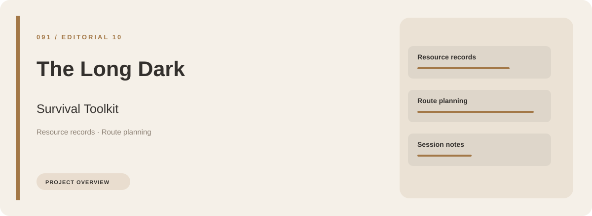
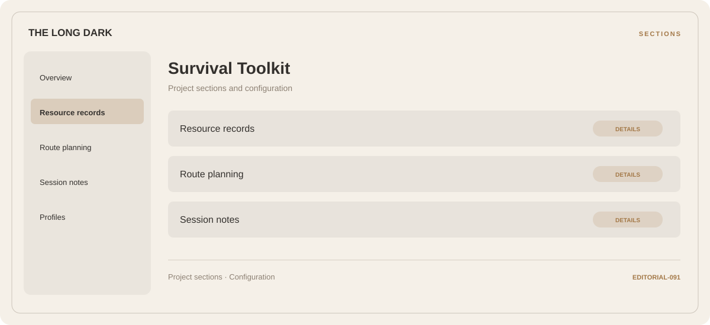

# 🧭 The Long Dark Survival Toolkit

**Resource records · Route planning · Session notes**

## ⚡ Features

The Long Dark Survival Toolkit groups resource records, route planning, and session notes in a single workspace. Each section keeps its controls and related settings together.

### ⚙️ Resource records

Inventory and resource categories organized alongside their related values and notes.

### 🧩 Route planning

Route stages, transport context, and the notes associated with each part of the journey.

### ⌨️ Session notes

Session and activity information grouped by the task or context it belongs to.

## 🖥️ Project navigation

## 📥 Download

The button and cover open the project's download page. Use the information supplied with the downloaded package for installation and release-specific requirements.

## 📚 Project documentation

- [Feature reference](docs/FEATURES.md)
- [Download information](docs/DOWNLOAD.md)
- [Project page](index.html)

---

The Long Dark Survival Toolkit · Program documentation and download information.
